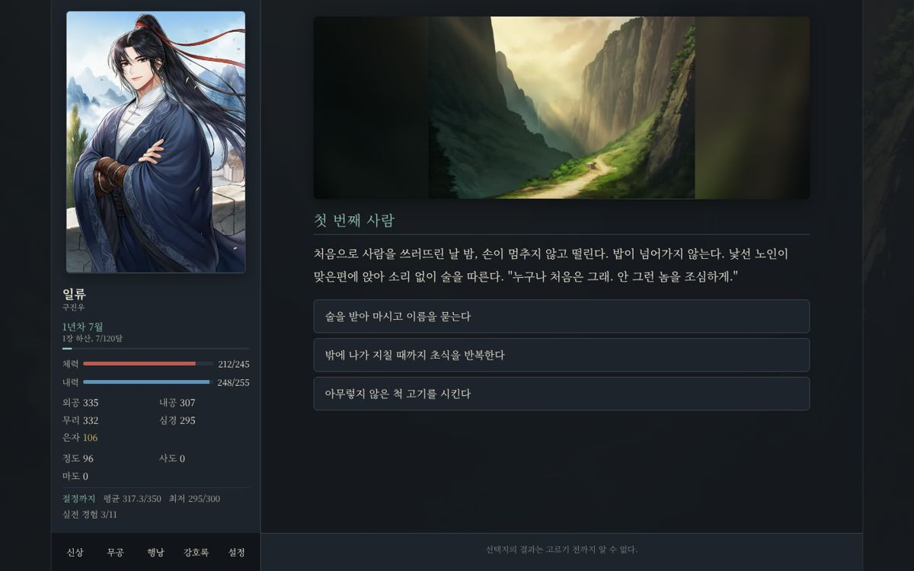
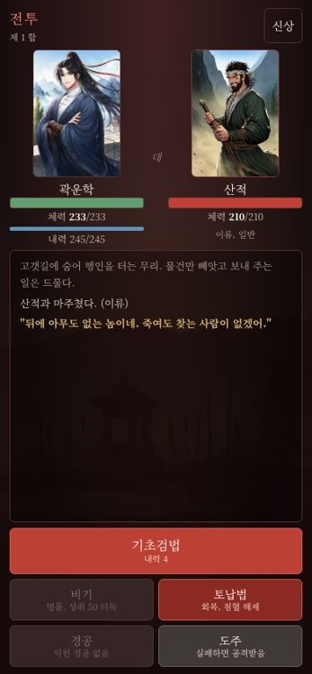

# 강호행

10년(120달) 동안 무공을 닦고 강호의 선택을 거쳐 천마봉에 오르는 한국어 무협 텍스트 로그라이크입니다.
쓰러져도 카르마가 남아 출신, 자질, 기틀, 인연, 전설의 유산을 얻고 다음 강호행이 단단해집니다.

**플레이: https://lesesang.github.io/Wuxia/**

설치 없이 휴대전화와 PC 브라우저에서 바로 실행되고, 한 번 열면 인터넷 없이도 돌아갑니다.
기록은 기기에 저장됩니다. 다른 기기로 옮기려면 설정의 "기록 옮기기"를 쓰세요.

<p>
  
  
</p>

## 무엇이 있나

| | |
|---|---|
| 출신 | 본편 8(강호초출과 검, 도, 창, 봉, 권, 장, 암기), 외전 27(구파일방, 세가, 사파, 마교, 혈교 등 저마다의 이야기와 결말) |
| 강호의 깊이 | 강호, 혈풍, 겁화, 천붕. 앞의 강호에서 천마를 꺾으면 다음 강호가 열린다 |
| 콘텐츠 | 사건 1,650여, 무공 340여, 물건 260여, 결말 86, 그림 690여 장 |
| 이어지는 것 | 카르마 상점(출신, 자질, 기틀, 인연, 채비), 전설의 유산, 장원, 강호록과 화첩 |

## 구조

서버가 필요 없는 정적 웹앱입니다. `www/` 폴더가 게임 전체입니다.

| 경로 | 내용 |
|---|---|
| `www/data/` | 사건, 적, 무공, 장터, 자질 같은 콘텐츠 (JSON) |
| `www/js/` | 게임 규칙(`game.js`, `battle.js`, `events.js` 등)과 화면(`ui.js`) |
| `www/css/`, `www/fonts/`, `www/icons/`, `www/img/` | 디자인, 내장 글꼴, 앱 아이콘, 그림 |
| `www/sw.js`, `www/manifest.webmanifest` | 오프라인 실행과 홈 화면 설치 |
| `tests/` | 자동 테스트 |
| `tools/` | 밸런스 시뮬레이터(`simulate.js`, `probe.js`, `fuzz.js`), 적 수치 맞춤, 오프라인 목록 생성 |
| `tools/content/` | 외전, 장원, 소속의 사건과 외전 결말, 적을 만드는 원본 |
| `tools/check/` | 사건 검증, 문장과 조사 점검, 화면 점검, 상점 값어치, 외전 마지막 싸움 측정 |
| `art/`, `tools/art/` | 그림 원본과 프롬프트, 게임용으로 줄여 연결하는 도구 |
| `docs/` | 설계서, 콘텐츠 가이드, 세계관 분석, 용어집, 앱 배포 안내 |
| `CLAUDE.md` | 작업 방식과 게임 규칙 |

## 개발

```
npm test                              # 자동 테스트
npm run serve                         # http://localhost:8000 에서 실행
node tools/simulate.js 300            # 봇으로 조건별 격파율 확인 (WORLD=혈풍 으로 깊은 강호)
node tools/probe.js 300               # 해마다 성장과 장별 난이도 측정
node tools/fuzz.js 60                 # 아무렇게나 끝까지 해 보며 오류와 막힘 찾기
node tools/check/audit.mjs            # 사건 검증
python3 tools/check/text_rules.py     # 문장 규칙과 이름 겹침 점검
node tools/check/sidefight.mjs 40 4 완성   # 외전 마지막 싸움의 승률
```

사건 원본을 고쳤으면 `tools/content`에서 `more_events.py`, `main_more.py`, `more_events2.py`, `sects_more.py`, `sect_life.py`, `build.py` 차례로 다시 만듭니다.
`www/`에 파일을 더하면 `node tools/build_asset_list.js`로 오프라인 목록을 다시 만듭니다.

## 작업과 배포

`main`에서 `claude/주제` 브랜치를 따서 작업하고, PR을 squash로 합칩니다. PR에는 자동 테스트와 문장 규칙 점검이 돌고(`PR 테스트`), `main`에 합치면 테스트를 다시 거쳐 GitHub Pages에 배포됩니다(`테스트 후 GitHub Pages 배포`). 배포할 때는 자료를 한 줄로 줄입니다. 앱 스토어 출시는 [docs/앱배포.md](docs/앱배포.md)를 보세요.

## 콘텐츠 추가

코드를 고치지 않고 `www/data/`의 JSON에 항목을 추가하면 게임에 나옵니다. 외전, 장원, 소속의 사건(`events_side.json`, `events_manor.json` 등)만은 `tools/content`의 원본을 고쳐 다시 만듭니다. 형식은 [docs/콘텐츠-가이드.md](docs/콘텐츠-가이드.md), 규칙 전체는 [docs/설계서.md](docs/설계서.md), 세계의 사실은 [docs/세계관-분석.md](docs/세계관-분석.md)에 있습니다.
